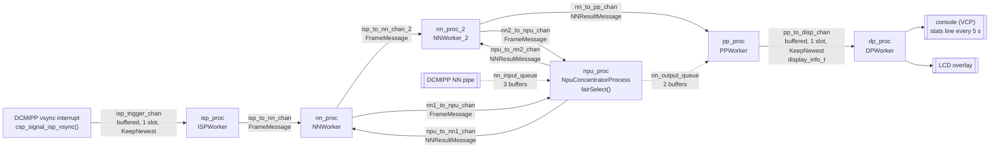

# A Static CSP Process Network for Multi-Pose Estimation on the STM32N6570-DK

This directory turns ST's multi-pose estimation example into a static network of **Communicating Sequential Processes (CSP)** on the STM32N6570-DK (STM32N657, Cortex-M55 at 800 MHz). It uses CSP4CMSIS from its `dev/tracing` branch (API identical to CSP4CMSIS 3.1.0) on FreeRTOS V10.6.2, through ST's CMSIS-RTOS2 wrapper; `main.c` starts the kernel with `osKernelInitialize()`/`osKernelStart()`. The pose model runs on the STM32N6's Neural-ART NPU.

The explanations for this code are in the book. `application.cpp` has no comments apart from a three-line header.

The figures below come from this branch running on the board in development boot: 60 s runs of Debug and DebugTrace, and DebugTrace captures of the first 3.2 s after boot. The [top-level README](../README.md) shows how to build, run and trace.

## 🏗 Architecture Overview

Six processes and nine channels replace the four FreeRTOS threads of ST's `Src/app.c`. `MainApp_Task` builds the network and starts it with `Run(..., ExecutionMode::StaticNetwork, NETWORK_PRIORITY)`.

**What is never copied:** camera frames and NN buffers stay where the hardware writes them:
- The DCMIPP's display pipe writes straight into the LCD background buffers.
- The NN pipe writes into one of three NN input buffers in PSRAM. The NPU reads that buffer in place and writes one of two NN output buffers, which post-processing reads in place.
- These buffers are handed on by ST's own buffer queues in `app.c` (`nn_input_queue`, `nn_output_queue`: FreeRTOS counting semaphores), not by the CSP channels.

**What is copied:** the channels carry small messages, each copied (`memcpy`) from writer to reader:
- `FrameMessage` (8 bytes): a buffer index, always 0, and the ISP's time stamp (`HAL_GetTick()`).
- `NNResultMessage` (8 bytes): the inference time and the frame period, both in ms.
- `display_info_t` (2712 bytes, ST's type in `Inc/app.h`): detections, tracking boxes and timings. It is copied twice, into `pp_to_disp_chan`'s slot by pp and out of it by dp.
- `trigger_t`, an empty struct, on `isp_trigger_chan`.

Channels without a "buffered" label in the diagram are rendezvous channels. The dashed lines are ST's buffer queues.



### 1. Camera vsync to ISP
* **The interrupt:** the DCMIPP's vsync interrupt (`DCMIPP_IRQn`) runs ST's callback chain:
  * `HAL_DCMIPP_PIPE_VsyncEventCallback()`
  * → `CMW_CAMERA_PIPE_VsyncEventCallback()` (for pipe 1)
  * → `app_main_pipe_vsync_event()`
  * → `csp_signal_isp_vsync()`, which writes a trigger to `isp_trigger_chan` with `isrWriter().putFromISR()`.
* **Why not a rendezvous channel:** a rendezvous completes only when writer and reader meet, so the writer must be able to wait. An interrupt cannot wait, and CSP4CMSIS gives rendezvous channels no ISR write path. A buffered channel's `putFromISR()` never blocks.
* **Why KeepNewest and not Block:**
  * Both DCMIPP pipes run continuously (`CMW_MODE_CONTINUOUS`). The camera does not wait for the software, as a capture re-armed after each frame would, so a vsync can arrive while the previous trigger is still unread.
  * With Block, that `putFromISR()` would fail. With KeepNewest, the new trigger overwrites the old one, so isp always handles the latest vsync. A missed vsync skips one ISP update (`CAM_IspUpdate()`), and the trace records it as `OverwroteOldest` instead of `PutFromISR`. A DebugTrace capture at the end of a 60 s run shows 2 such events among 73 vsyncs (see point 4).
* **Interrupt priorities:**
  * An interrupt whose handler calls FreeRTOS or CSP4CMSIS must have a priority numerically at or above `CSP4CMSIS_MAX_SYSCALL_INTERRUPT_PRIORITY` = 5 (equal to `configLIBRARY_MAX_SYSCALL_INTERRUPT_PRIORITY`). The STM32N6 has 4 priority bits.
  * As read from the NVIC on the board:

| Interrupt | Priority | Set by |
|---|---|---|
| DCMIPP, CSI | 7 | ST's camera middleware (`cmw_camera.c`) |
| NPU (line 0) | 5 | ST's NPU runtime (`ll_aton_osal_freertos.h`) |
| SysTick, PendSV | 15 | the FreeRTOS port (`configKERNEL_INTERRUPT_PRIORITY`) |
| all other interrupts | SysTick's priority (15) | ST's `main.c` (`main_thread_fct()`) |

### 2. Sharing the NPU
* **The concentrator:** nn and nn_2 both send each frame to the concentrator (`npu_proc`) and wait for its reply. The concentrator waits on both request channels with one ALT and `fairSelect()`, which rotates the starting guard so that both requesters get their turn.
* **One inference per frame:**
  * nn's request (guard 0) is answered at once, without inference, with `inf_ms = 0` and the period between nn's frames. nn then passes the frame on to nn_2.
  * nn_2's request (guard 1) runs `NN_Execute_Inference()` and answers with the inference time and the period between nn_2's frames.
  * The concentrator also initialises the NPU (`NN_Hardware_Init()`) before its loop.
* **The NPU wait blocks:**
  * `NN_Execute_Inference()` runs the network asynchronously (`stai_network_run(..., STAI_MODE_ASYNC)`) and waits in `LL_ATON_OSAL_WFE()`. With ST's FreeRTOS OSAL that is `xSemaphoreTake(..., portMAX_DELAY)` on a static semaphore, which the NPU's interrupt handler (`ATON_STD_IRQHandler()`) gives with `xSemaphoreGiveFromISR()`.
  * While the NPU runs, the concentrator is blocked and the CPU is free: in the traces, other tasks are switched in during every inference.
  * Measured in DebugTrace: an inference takes 32.50–33.03 ms.

### 3. Post-processing and display
* **pp → dp through KeepNewest:**
  * pp writes each frame's `display_info_t` to `pp_to_disp_chan` (one slot, KeepNewest) and goes back to waiting for nn_2. If dp has not yet taken the previous result, the newer one replaces it. So the display never holds up inference.
  * The copy of the 2712-byte `display_info_t` runs inside CSP4CMSIS's critical section, so interrupts at priority 5 and below (numerically ≥ 5) are held off for the duration of that `memcpy`.
* **dp:** draws the detections into the LCD's foreground layer (`LCD_Render_Frame()`). Every 5 s it prints a stats line on the console: `stats fps … inf …ms cpu …%`.
* **Who prints while the network runs:**
  * dp's stats line;
  * pp, through ST's `app_tracking()`, which prints `Enable tracking` / `Disable tracking` when the USER1 button toggles tracking (`TRACKER_MODULE` is defined in both build configurations);
  * a failed `assert()` in any process.

  ST's `_write()` sends to the UART without a lock. **dp is therefore not the only owner of the console:** pressing USER1 makes pp print too.
* **Before the network runs:** ST's main thread prints the banner (`app_run()`), then `MainApp_Task` prints `--- Launching STM32N6 AI Parallel Network ---`.

### 4. One network priority
* **Priorities:**
  * All six processes run at `NETWORK_PRIORITY` (`osPriorityLow`, FreeRTOS priority 8).
  * `MainApp_Task` runs above them (`osPriorityBelowNormal`, 16) and only builds and starts the network, then exits (`osThreadExit()`).
  * FreeRTOS does not preempt a running task for a ready task of the same priority. With time slicing, its default, it switches at the next tick (1 kHz).
* **Frames are slower than the camera:** in a DebugTrace capture of the last 2.4 s of a 60 s run:
  * the vsync period is 33.25–33.31 ms (mean 33.28 ms), but frames reach dp every 34.08 ms on average;
  * an inference takes 32.50–33.03 ms;
  * between nn_2's result and the concentrator's next selection of nn_2's request there are 0.02–1.99 ms (mean 1.23 ms).
* **The cause, from the trace:**
  * After nn_2's result, nn_2 and nn hand the next frame on, and the concentrator answers nn's request. nn_2's request is then pending, but dp is drawing at the same priority.
  * In 70 of 71 cycles, the concentrator got the CPU to select nn_2's request only when the tick preempted dp (within 20 µs after the tick, median 1.4 µs).
  * The pipeline therefore falls behind the camera, and now and then a vsync finds the previous trigger unread (2 `OverwroteOldest` in 73 vsyncs, point 1).
  * In captures of the first 3.2 s after boot, the same handoff happens in 52–56 of about 70 cycles; in 13–16 the concentrator runs as soon as pp blocks.
* **The stats line shows a single frame:**
  * `fps` is 1000 divided by the period of the last frame, between the time stamps isp gave two consecutive frames, in whole milliseconds. So it shows values such as 29.41 (34 ms) or 30.30 (33 ms), not an average. `inf` is that frame's inference time, `cpu` ST's CPU load over the last second.
  * In two 60 s Debug runs, 15 of 22 stats lines show 30.30 fps and 7 show 29.41 fps, with inference 32 ms and CPU load 38.2–38.4 %. Whole-millisecond periods cannot show whether Debug keeps pace with the camera; the trace exists only in DebugTrace.
  * In two 60 s DebugTrace runs, the lines show 27.78–31.25 fps, inference 32–33 ms and CPU load 38.2–39.9 %.

### 5. Memory
* **No RTOS heap:**
  * FreeRTOS is built without dynamic allocation (`configSUPPORT_DYNAMIC_ALLOCATION 0`), so no FreeRTOS object can come from a heap.
  * Every CSP object is static: the processes with their stacks and thread control blocks (`CSProcessStatic<2048>`: 2048 words, 8192 bytes each), the channels, and `MainApp_Task`'s stack and control block.
  * ST's buffer queues use statically allocated semaphores too.
* **The newlib heap:**
  * The C library's heap is bounded: 4096 bytes (`_Min_Heap_Size` in the linker script), and `_sbrk()` (`Gcc/Src/syscalls.c`) fails beyond `_eheap` instead of running into other data.
  * After 60 s, 1264 bytes have been taken from it, in Debug and in DebugTrace alike (the heap break read by the debugger).
* **Stack sizes:** 6 × 8192 bytes for the processes and 1024 bytes for `MainApp_Task`; the measured use is in [Stack Occupancy](#-stack-occupancy).

### 6. Tracing (DebugTrace)
* **What is recorded:**
  * Every CSP event of the library: channel waits, rendezvous, buffered puts and gets (including the ISR's), overwrites, ALT selections, process start.
  * FreeRTOS task creation and task switches.
  * A heartbeat once per second from the tick hook.
* **No channel values:** no event records any part of a channel's values, only library state.
* **The ring:**
  * 16384 records of 16 bytes (256 KB) in a `NOLOAD` section after the newlib heap (`csp_trace.ld`), made non-cacheable by MPU region 0 (`csp_trace_board.c`).
  * Time stamps come from DWT_CYCCNT.
  * The debugger dumps the ring; CSP4CMSIS's tools decode it and check it against the library's formal models.
  * `tools/isr_writers.json` names `isp_trigger_chan` as the one channel an interrupt writes.
* **Conformance on silicon:** captures of the first 3.2 s after boot (`RING_POLICY=stop`) have 10 projections: the 7 rendezvous channels, the concentrator's ALT and the 2 KeepNewest channels. In each:
  * all trace checks pass (about 290 per capture; the count varies with timing), as do the 6 stable-failure checks, proved with ProB;
  * all 10 mutants (the trace with one injected fault) are caught;
  * 85.7 % of the recorded CSP events lie in a checked projection.

  The commands are in the top README's [Trace](../README.md#trace) section.

---

## 🔧 Key Code Snippets

Excerpts from `application.cpp`; see the file for the complete code.

### The vsync interrupt and isp
```cpp
struct trigger_t {};

static BufferedChannel<trigger_t, 1, BufferPolicy::KeepNewest> isp_trigger_chan;

extern "C" void csp_signal_isp_vsync(void) {
  isp_trigger_chan.isrWriter().putFromISR(trigger_t{});
}

// ...

class ISPWorker : public CSProcessStatic<2048> {
  Chanin<trigger_t> trigger_in;
  Chanout<FrameMessage> out;

 public:
  ISPWorker(Chanin<trigger_t> r, Chanout<FrameMessage> w) : trigger_in(r), out(w) {}

  void run() override {
    trigger_t trig;
    while (true) {
      trigger_in >> trig;
      CAM_IspUpdate();
      FrameMessage msg = { 0, HAL_GetTick() };
      out << msg;
    }
  }
};
```

### The NPU concentrator
```cpp
  void run() override {
    NN_Hardware_Init();
    uint32_t last_ts_m1 = 0;
    uint32_t last_ts_m2 = 0;
    FrameMessage r1;
    FrameMessage r2;
    Alternative npu_alt(req_m1_in | r1, req_m2_in | r2);
    while (true) {
      int sel = npu_alt.fairSelect();
      if (sel == 0) {
        uint32_t period = r1.timestamp - last_ts_m1;
        last_ts_m1 = r1.timestamp;
        NNResultMessage res = { .inf_ms = 0, .period_ms = period };
        resp_m1_out << res;
      } else {
        uint32_t period = r2.timestamp - last_ts_m2;
        last_ts_m2 = r2.timestamp;
        uint32_t inf_ms = NN_Execute_Inference();
        NNResultMessage res = { .inf_ms = inf_ms, .period_ms = period };
        resp_m2_out << res;
      }
    }
  }
```

### Network construction (`MainApp_Task`)
```cpp
static constexpr osPriority_t MAIN_APP_PRIORITY = osPriorityBelowNormal;
static constexpr osPriority_t NETWORK_PRIORITY  = osPriorityLow;

alignas(8) static uint32_t mainAppStack[256];
static StaticTask_t mainAppControlBlock;

void MainApp_Task(void* argument) {
  (void)argument;
  osDelay(10);
  printf("\r\n--- Launching STM32N6 AI Parallel Network ---\r\n");

  static Channel<FrameMessage> isp_to_nn_chan;
  static Channel<FrameMessage> isp_to_nn_chan_2;
  static Channel<NNResultMessage> nn_to_pp_chan;
  static BufferedChannel<display_info_t, 1, BufferPolicy::KeepNewest> pp_to_disp_chan;
  static Channel<FrameMessage> nn1_to_npu_chan;
  static Channel<NNResultMessage> npu_to_nn1_chan;
  static Channel<FrameMessage> nn2_to_npu_chan;
  static Channel<NNResultMessage> npu_to_nn2_chan;

  static ISPWorker isp_proc(isp_trigger_chan.reader(), isp_to_nn_chan.writer());
  static NNWorker nn_proc(isp_to_nn_chan.reader(), isp_to_nn_chan_2.writer(),
                          nn1_to_npu_chan.writer(), npu_to_nn1_chan.reader());
  static NNWorker_2 nn_proc_2(isp_to_nn_chan_2.reader(), nn_to_pp_chan.writer(),
                              nn2_to_npu_chan.writer(), npu_to_nn2_chan.reader());
  static NpuConcentratorProcess npu_proc(nn1_to_npu_chan.reader(), nn2_to_npu_chan.reader(),
                                         npu_to_nn1_chan.writer(), npu_to_nn2_chan.writer());
  static PPWorker pp_proc(nn_to_pp_chan.reader(), pp_to_disp_chan.writer());
  static DPWorker dp_proc(pp_to_disp_chan.reader());

  Run(InParallel(isp_proc, nn_proc, nn_proc_2, npu_proc, pp_proc, dp_proc),
      ExecutionMode::StaticNetwork, NETWORK_PRIORITY);
  osThreadExit();
}
```

## 📊 Stack Occupancy

The application prints no stack report. The figures below were read by the debugger:
* FreeRTOS fills every new task's stack with `0xA5`.
* After 60 s of running, the debugger halted the board and read each process stack and `mainAppStack`.
* Used bytes are those no longer `0xA5`, counted from the far end of the stack, as `uxTaskGetStackHighWaterMark()` does.

| Task | Allocated | Used (Debug) | Unused headroom (Debug) | Used (DebugTrace) | Unused headroom (DebugTrace) |
|---|---|---|---|---|---|
| isp_proc | 8192 bytes | 440 bytes | 7752 bytes | 568 bytes | 7624 bytes |
| nn_proc | 8192 bytes | 224 bytes | 7968 bytes | 248 bytes | 7944 bytes |
| nn_proc_2 | 8192 bytes | 224 bytes | 7968 bytes | 248 bytes | 7944 bytes |
| npu_proc | 8192 bytes | 1664 bytes | 6528 bytes | 1776 bytes | 6416 bytes |
| pp_proc | 8192 bytes | 3272 bytes | 4920 bytes | 3280 bytes | 4912 bytes |
| dp_proc | 8192 bytes | 3664 bytes | 4528 bytes | 3672 bytes | 4520 bytes |
| MainApp | 1024 bytes | 256 bytes | 768 bytes | 316 bytes | 708 bytes |

* **Worst observed so far:** these are *worst-observed-so-far* values. They cover only the code paths the runs exercised. USER1 was not pressed, so pp's tracking messages are not included, and no error path ran.
* **MainApp:** its figure is final, since it exits after starting the network.
* **Every process uses less than half of its 8 KB stack.** The largest use, dp's, is 3672 bytes.

## 🚀 How to Run

Follow the top-level README:
1. [Model](../README.md#model): the model must be generated and in the board's external flash first.
2. [Clone and build](../README.md#clone-and-build): Debug or DebugTrace.
3. [Run](../README.md#run-development-boot): development boot, loaded into RAM.
4. [Trace](../README.md#trace): DebugTrace.

## 📁 File Structure
```text
CSP/
├── application.cpp      // The process network: processes, channels, MainApp_Task
├── app_application.h    // Bridge to ST's app.c: the stage functions and the network's entry points
├── csp_trace_board.c    // DebugTrace: the trace ring, its MPU region, initialisation, tick heartbeat
├── csp_trace.ld         // DebugTrace: linker fragment placing the ring after the newlib heap
├── LICENSE              // MIT, Oliver Faust
├── README.md            // This file
└── tools/
    ├── run_dev.sh       // Load into RAM, run, capture the console
    ├── trace_dev.sh     // Load, run, dump the trace ring; decode and check it
    ├── section_hash.sh  // Size and SHA-256 of each loadable ELF section
    └── isr_writers.json // isp_trigger_chan is written by an interrupt
```

## 🐛 Troubleshooting
* **No stats line yet:** dp prints its first stats line with the first frame it receives at least 5 s after it started. A shorter run shows only ST's banner and the `Launching` line.
* **`run_dev: HAL_BSEC_OTP_Program reached; resetting target, OTP not written`** (or `trace_dev: …`): ST's `Fuse_Programming()` was about to program the OTP fuses on a board whose bits are not set yet. The script reset the target and stopped: it will not run the application on such a board. See the top README's [Fuse_Programming()](../README.md#fuse_programming) section; the decision is yours.
* **`trace_dev: target not released`:** the GDB session ended before the application was released to run. `trace_dev.sh` prints the GDB log just before this line. One cause is the OTP guard above (exit status 1).
* **Frame rate below 30 fps:** expected. The stats line shows single frames, and with one network priority the pipeline is a little slower than the camera's 33.28 ms (see [One network priority](#4-one-network-priority)).

## 📝 License
`CSP/` is MIT-licensed (`CSP/LICENSE`, Oliver Faust). ST's code keeps ST's terms; see [`LICENSE.md`](../LICENSE.md) and the files themselves.
